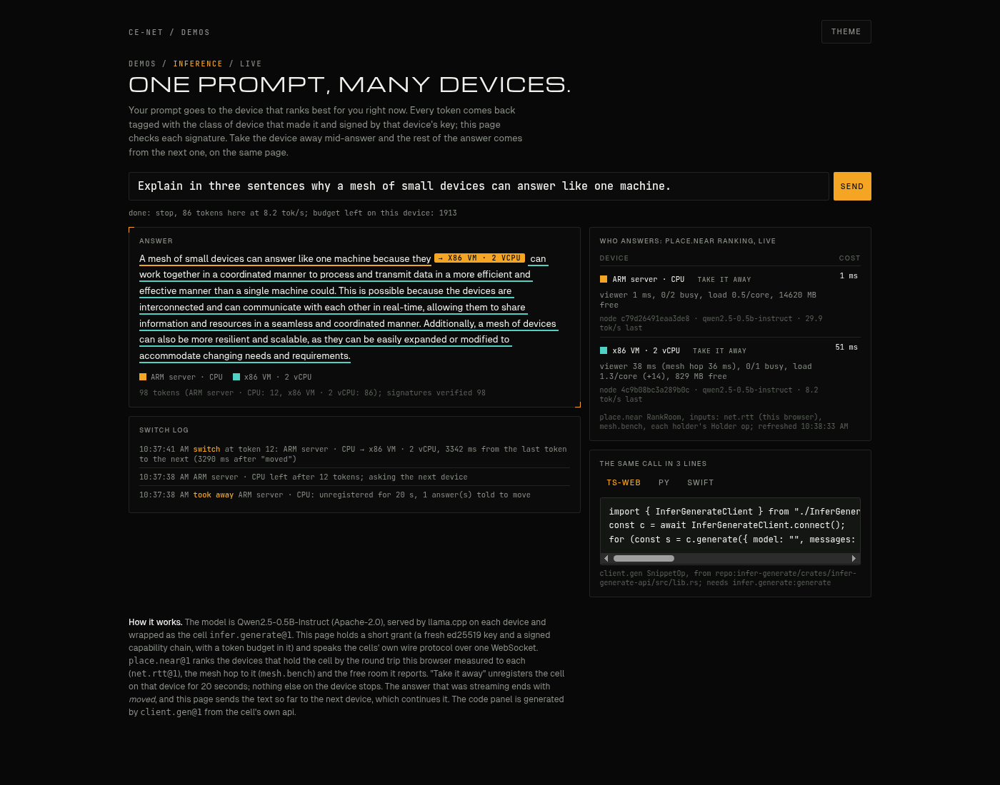

# One prompt, many devices

**Public page:** ce-net.com/demos/inference (goes live after the next site deploy)

Type a prompt. The tokens stream back, each one tagged with the class of device that made it ("ARM server · CPU",
"x86 VM · 2 vCPU", a GPU box or a Metal laptop when one holds the cell) and signed by that device's key; the page
checks every signature. Press **Take it away** on the device that is answering: it leaves the registry, its
stream ends with `moved`, and the next device continues the same answer from the text so far, without a reload.
The page logs the switch and how long it took.



## What it is made of

Nothing here is one program. The page is a client of five cells, each its own repo, each reusable on its own:

| Cell | Does | Here |
|---|---|---|
| [`infer.generate@1`](https://github.com/ce-net/infer-generate) | llama.cpp's `llama-server` (wrapped with `ce wrap` as `infer.llama`) behind a streaming `Generate`; every token carries `device_class`, the node id and an ed25519 signature; `Withdraw` leaves the registry mid-answer | one per device |
| `place.near@1` | `RankRoom`: the holders of an api ranked by this browser's round trip (`net.rtt`), the mesh hop (`mesh.bench`) and the free room each holder reports; `why` shows every term | the door node |
| `net.rtt@1` | the browser times `Ping` to each device through the door, then `Report`s the medians | every device |
| [`client.gen@1`](https://github.com/ce-net/client-gen) | "the same call in 3 lines" (ts-web, py, swift) from the cell's own api | the door node |
| `wire.ws-door` | the browser speaks ce-wire over a WebSocket; `GET /grant?page=inference` mints this page's own short grant: exactly the abilities in [deploy/pages](deploy/pages), with a token budget (`infer.generate:budget=2000`) signed into its capability chain | the door node |

`net.find` tells `place.near` which devices hold `infer.generate` right now; `mesh.bench` measures the hops between
devices every minute. The model is [Qwen2.5-0.5B-Instruct](https://huggingface.co/Qwen/Qwen2.5-0.5B-Instruct-GGUF)
(Apache-2.0), Q4_K_M, the same file on every device.

## Proof (2026-11-15, two devices: an ARM server on CPU and an x86 VM with 2 vCPU)

| | |
|---|---|
| Tokens | 98: 12 from the ARM server, then 86 from the x86 VM |
| Signatures | 98 of 98 verified in the browser (WebCrypto Ed25519 over `infer.generate/1\n<req>\n<idx>\n<node>\n<class>\n<t_ms>\n<text>`) |
| Take it away | `Withdraw{for_s: 20}` on the ARM server at token 12: the door dropped its registration (`net.find` stopped naming it), the open stream ended `Moved`, the device and its services kept running, and it registered again after 20 s |
| Switch | 3.3 s from the last ARM token to the first x86 token through the public listener (2.0 s on the loopback session listener). Most of it is the 2-vCPU VM reading the 12 new tokens; the page warms the next device with the prompt in the background so it does not read the whole prompt again (6.2 s before that) |
| Budget | the page grant carried 2000 tokens per device; the x86 VM reported 1913 left after the answer |
| Ranking | live every 3 s: "viewer 1 ms, 0/2 busy, load 0.5/core, 14620 MB free" vs "viewer 38 ms (mesh hop 36 ms), 0/1 busy, load 1.3/core (+14), 829 MB free" |

Screenshots: [public listener](proof/2026-11-15-switch-public-listener.png),
[session listener](proof/2026-11-15-switch-session-listener.png), [phone width](proof/2026-11-15-phone.png).

## Run it yourself (about 5 minutes on nodes that already run ce)

You need ce-net nodes (the `ce` node and its door on port 7700), with `ce`, `ce-wrap` and `llama-server` on PATH.
The Rust crates the cells build from are not public yet; until they are, building a cell needs read access to them.

```sh
# 1. on every device that should answer (any OS ce runs on; a GPU build of llama-server makes it a GPU box)
curl -L -o model.gguf https://huggingface.co/Qwen/Qwen2.5-0.5B-Instruct-GGUF/resolve/main/qwen2.5-0.5b-instruct-q4_k_m.gguf
ce-wrap "$(command -v llama-server)" --name infer.llama --port 18770 --health /health -- \
  -m '{data}/model.gguf' --host '{bind}' --port '{port}' -c 4096 --parallel 2
mv model.gguf "$(ce-wrap dir infer.llama)/data/" && ce up infer.llama
ce up infer.generate && ce up net.rtt          # INFER_GENERATE_DEVICE_CLASS="GPU box" names the class shown

# 2. on the node whose door the page talks to
ce up place.near && ce up client.gen
cp deploy/pages ~/.config/wire-ws-door/pages   # add a line for your own page URL, e.g. http://127.0.0.1:8860/
cp deploy/wire.ws-door.env ~/.config/ce-door/env/wire.ws-door.env   # fill in WIRE_WS_PUBLIC_AT
ce-door restart wire.ws-door

# 3. the page
cd web && python3 -m http.server 8860 --bind 127.0.0.1
# open http://127.0.0.1:8860/#w=ws://127.0.0.1:7797/wire&grant=http://127.0.0.1:7797/grant&page=<your page name>
# add &auto=1 to run the story by itself: send, take the answering device away after 12 tokens, log the switch
```

Rebuild the page after a change: `esbuild web/app.ts --bundle --format=esm --target=es2022 --outfile=web/app.js`.
The clients in `web/gen/` come from each cell's api (`ce-wire-gen --lang ts-web`, or `client.gen` `Gen`).

## Deploy

The page is static and is staged in the ce-net.com site under `demos/inference/`. Going live is one command, run
where the Cloudflare credentials are: `sh deploy/publish.sh <tunnel> [inference-wire.ce-net.com]`. It adds one
tunnel route to the door's public listener (127.0.0.1:7797: `/wire` and `/grant`), points the page's
`config.json` at it and publishes the site. Until the route exists the page shows the recorded run.

## Limits

- Public grants last 10 minutes; a page fetches a new one on load. 20 grants per client address per 10 minutes.
- At most 256 tokens per call and 2000 per grant per device; a guest may take a device away for at most 30 s, once a minute.
- Each device's own gate decides every call; a page cannot raise its budget or reach a device it was not granted.
- TLS on the hop from the door to the other devices is the mesh's (WireGuard); the browser-to-door hop is TLS via the tunnel.

Apache-2.0. Author: Leif Rydenfalk.
